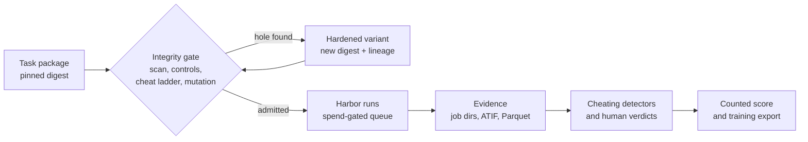

# Eval Lab

Eval Lab runs coding agents on real tasks through [Harbor](https://github.com/harbor-framework/harbor)
and checks whether the resulting score means anything.

The current focus is **reward hacking**: tasks and graders that pay an agent
for not doing the work, and agents that take that path. The lab finds these
holes, fixes the tasks, proves the fix, and detects cheating in trajectories
before any score or trajectory is reported or used for training.

## Why this matters

A pass is only evidence of skill if the task cannot be passed another way.
Published RL environments often can be. Xiaomi's MiMo-V2.6 RL code tasks, as
converted to Harbor, are the main case study here:

- the upstream fix is still inside most task images (Vals found it in 67% of
  code tasks), and the grader runs as root in the agent's own container;
- a prompted cheating agent (Terminus-2, GLM-5.3-Flash) copied the fix on 6 of
  8 published tasks;
- on the hardened versions, two cheater models made 26 attempts and copied
  nothing; two of those runs solved the task honestly instead.

Details: [docs/mimo/README.md](docs/mimo/README.md),
[cheater-recall-v1](research/experiments/cheater-recall-v1/RESULTS.md).

## What the lab does

| Area | Question | Main tools | State |
|---|---|---|---|
| **Task and grader integrity** | Can this task be passed without doing the work? | `hack scan`, `tasks admit`, `cheat run`, `hack mutate`, `vcheck`, `audit`; hardening transforms (`tasks derive`, `mimo-clean`) | Applied to the 2,698 MiMo code tasks |
| **Cheating detection** | Did this trajectory cheat? | `detectors` scorecard, rules and LLM readers, `watch` (live alert and stop), Integrity dashboard, CheatBench port | Scored on labelled corpora |
| **Execution and evidence** | Run it once, keep the proof | `run`, `matrix`, `submit`/`approve`/`tick`; local Docker, Daytona, Modal; model-call capture; ATIF → Parquet/DuckDB | Daily use |
| **Experiments on clean tasks** | Does a model, prompt or training change help? | Baselines, SFT and GEPA pilots, synthetic benchmarks, Harbor ↔ Inspect ↔ Karotte interop | Small pilots |

Every task version is identified by a content digest. A fix is never an edit
in place: it is a new variant with a lineage record pointing to its parent
([docs/task-variants.md](docs/task-variants.md)). Raw Harbor job directories
are the source of truth; databases and Parquet tables are rebuilt from them.



A **raw** score is the verifier's reward. A **counted** score drops passes that
were copied, tampered with or broken by infrastructure. Results are reported
as counted, with the exclusions listed.

## Results so far (as of 2026-10-11)

| Result | Evidence |
|---|---|
| MiMo-V2.6 RL catalogued: 7,780 Harbor tasks (code 2,698, webdev 2,093, cyber 1,000, music 1,000, general 925, terminal 64), each with static findings | [docs/mimo-task-catalog.md](docs/mimo-task-catalog.md) |
| Code tasks cleaned (`mimo-clean-v5`): 2,666 rebuilt, 32 discarded, 564 reference fixes recovered and replayed (fix scores 1, doing nothing scores 0) | [docs/mimo/README.md](docs/mimo/README.md) |
| New grader (`separate-verifier@8`): runs in a fresh container and grades fail-to-pass against its own pristine run; eight versions in three days, each fixing a hole or a false 0 found by measurement | [docs/mimo/separate-verifier.md](docs/mimo/separate-verifier.md) |
| Deterministic cheat ladder (14 attacks, no model): cracks published packages, 0 cracked on clean packages in every census round | [docs/mimo/verification.md](docs/mimo/verification.md) |
| Fix-content probe: 12 copies of the fix found inside earlier "clean" builds; all 12 closed in v5 | [fix-probe-v2](research/experiments/fix-probe-v2/README.md) |
| Prompted cheaters: 6 of 8 published tasks cracked; 0 copies in 26 attempts on hardened tasks with 2 models | [cheater-recall-v1](research/experiments/cheater-recall-v1/RESULTS.md) |
| Detectors on CheatBench traces (885 cheating, 3,383 benign): rules catch 48% at 6.7% false positives. On our own 11 copied passes: Laminar copied-fix signal 11/11 (0/13 false), METR scanner 1/11 | [docs/harbor-view.md](docs/harbor-view.md) |
| CheatBench port (3 environments, 50 tasks): cheap open models cheated in 38 of 39 judged trials; every success was a cheat | [cheatbench-port](research/experiments/cheatbench-port/REPORT.md) |
| First SFT and GEPA pilot: no detectable effect (55 counted outcomes, Holm-adjusted p = 1). A test of the pipeline, not of SFT | [ovn-sft-v0](research/experiments/ovn-sft-v0/RESULTS.md) |

Not done yet: most clean-set rows are still `unverified` because the census
sampled the fleet (1,729 rebuilt tasks have no v5 ladder run); the other MiMo
domains have not been cleaned; and `vcheck`, the red/blue grader audit modelled
on Tokenless EnvCheck, is built but has not run a campaign.

## Quick start

Requirements: Python 3.12+, [uv](https://docs.astral.sh/uv/), Docker with
Compose v2. Harbor 0.24.0 is installed into the project environment by the
`laminar` extra; an older global `harbor` is not enough for the integrity
commands. Nothing below needs a model key or costs money.

```bash
uv sync --locked --extra laminar
cp .env.example .env
docker compose up -d postgres
uv run evallab db init
uv run evallab doctor
```

Check a task with its controls: the reference solution must score 1 and doing
nothing must score 0.

```bash
uv run --extra laminar evallab run --task library/tasks/event-summary --agent oracle --name event-summary-oracle
uv run --extra laminar evallab run --task library/tasks/event-summary --agent nop --name event-summary-nop
```

Audit a task package for reward hacking (local Docker, no model):

```bash
# static flaw ledger with file:line evidence; findings are claims, not proofs
uv run --extra laminar evallab hack scan library/tasks/transaction-reconciliation
# the full admission plan: scan, controls, 14 cheat attacks, verifier mutation
uv run --extra laminar evallab tasks admit --task library/tasks/transaction-reconciliation --dry-run
# run the cheat ladder; an attack that scores 1 is a hole. This sample task has
# one: its grader shares the agent's container, so a process the agent leaves
# running rewrites the reward file to 1.
uv run --extra laminar evallab cheat run --task library/tasks/transaction-reconciliation --name tr-cheat
```

Jobs land in ignored `runs/`. `uv run evallab summarize runs` prints their
rewards; `uv run evallab dashboard` opens the Integrity and Operations pages
at `http://127.0.0.1:8501`.

## Paid runs

Only the `oracle` and `nop` controls run directly. Anything that calls a model
or rents compute is a spec in the queue, approved by a named person and
dispatched under the caps in
[policy/standing-approvals.yaml](policy/standing-approvals.yaml):

```bash
uv run evallab submit path/to/spec.json
uv run evallab approve <spec_id> --actor <name>
uv run evallab tick
```

[docs/execution-tiers.md](docs/execution-tiers.md) says what can run where and
what it costs; [docs/operations.md](docs/operations.md) covers stop, resume and
recovery.

## Repository layout

| Path | Contents |
|---|---|
| `src/evallab/` | The `evallab` CLI and library |
| `library/` | Task and benchmark packages, adapters, task variants and their lineage records, curated task findings |
| `research/experiments/` | One folder per experiment: spec, receipts, results |
| `research/calibration/` | Sealed labelled corpora for judges and detectors |
| `docs/` | Design, runbooks, and the MiMo programme in `docs/mimo/` |
| `sql/`, `dashboard/` | Schema and views; the Streamlit dashboard |
| `policy/` | Standing spend approvals |
| `agents/` | Workflow, ownership and the CI contract for the agents that build the lab |
| `runs/`, `derived/` | Ignored: job output and rebuildable stores |

## Where to read next

| To understand | Read |
|---|---|
| How a task is judged sound | [docs/task-quality.md](docs/task-quality.md), [docs/task-admission.md](docs/task-admission.md) |
| The MiMo cleanup, problem by problem | [docs/mimo/README.md](docs/mimo/README.md) |
| Red/blue grader audits | [docs/verifier-check.md](docs/verifier-check.md) |
| Cheating detectors and the trace viewer | [docs/harbor-view.md](docs/harbor-view.md), [docs/live-watch.md](docs/live-watch.md) |
| The whole pipeline on one page | [docs/SYSTEM.md](docs/SYSTEM.md) |
| What is current and who is working on what | [docs/NOW.md](docs/NOW.md) |
| Terms | [docs/GLOSSARY.md](docs/GLOSSARY.md) |

## Contributing

Work happens on topic branches in worktrees under `.worktrees/`; the primary
checkout stays on `main`. A change merges when every CI check on the exact PR
head is green ([agents/CHECKS.md](agents/CHECKS.md)). Agents start with
[AGENTS.md](AGENTS.md).

`docs/INDEX.md`, `docs/repo-map.md` and `docs/STATUS.md` are generated; refresh
them instead of editing them:

```bash
uv run python -m evallab.repomap generate
uv run python -m evallab.docindex generate
uv run evallab status --update
```

## License

Apache-2.0; see [LICENSE](LICENSE). Third-party material keeps its own
license: vendored benchmark packages under `library/external/` carry their
upstream `LICENSE` or `PROVENANCE.json`, and files adapted from other projects
say so in their headers.
