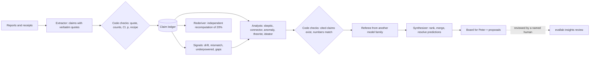

# Insight engine: always-on analysts over experiment results

`evallab insights` reads what experiments report, checks it, and keeps analyst
agents working on the whole body of results while new experiments run. It
implements Stage 6 (cross-trial synthesis) and the proposal half of Stage 7 of
[the analysis loop](analysis-loop.md) at the level of experiments rather than
single trials. Statistics come first and are computed by code; the agents look
for what statistics alone does not show.

## What it does



1. **Sources.** Coordinator findings logs, lane reports, results-folder reports,
   line scoreboards and committed experiment RESULTS, as listed in
   `config.yaml`. Markdown is split into sections; a section is extracted once
   and again only if its text changes.
2. **Claims.** The extractor writes one claim per number-bearing statement with
   a verbatim quote. Code then fails a claim whose quote is not in the section
   or whose counts are not in the quote, warns on arithmetic that does not add
   up (value vs k/n, Wilson interval, exact McNemar p), and, when the claim
   carries a declarative `recipe`, recomputes the number from the experiment's
   own receipts: `reproduced`, `differs` or `not_recomputable`.
3. **Signals.** Deterministic statistics over every claim at once: the same
   measurement disagreeing across experiments, extreme rates on small samples,
   comparisons that cannot reach p < 0.05 at their sample size, nulls without
   power, results that do not survive multiple-comparison correction,
   corrections whose downstream claims were never revisited, and detector by
   dataset cells nobody measured.
4. **Analysts.** Each lens is a headless `omp -p` worker with a fixed brief
   (`src/evallab/insights/lenses/`), a bounded evidence pack and a read-only
   `./q` tool (SQL over the ledger, sources, statistics, recipe tests, output
   validation). Lenses read each other's recent cards, so a connector's link
   becomes a theorist's input and a skeptic's target.
   - *skeptic*: flaws in load-bearing claims and the cheapest decisive check;
   - *connector*: one mechanism behind results of two or more experiments;
   - *anomaly*: explains open signals from the underlying receipts;
   - *theorist*: mechanisms with falsifiable predictions in untested regions;
   - *ideator*: new experiments, reanalysis of existing data first, with cost.
5. **Quality control.** Code fails a card that cites an unknown, stale or
   failed claim, a "connection" inside one experiment, or a statistic that does
   not recompute, and lists numbers that appear in no cited claim. A referee
   from a different model family grades support, novelty, falsifiability and
   importance; a referee served by the authors' family is not applied. The
   synthesizer ranks what survives, merges duplicates and resolves predictions
   against later claims. Proposals are written to `proposals/` with
   `execution_authorized: false`.
6. **Acceptance.** Only a named human accepts or rejects an insight:
   `evallab insights review <insight_id> accepted --by "Peter Makhnatch"`
   (same vocabulary and human-actor rule as [verdicts](verdicts.md)).

## Running it

```bash
uv run evallab insights init          # state dir with editable config.yaml and routes.yaml
uv run evallab insights status        # alive? what is each lens waiting for?
uv run evallab insights tick --dry-run
uv run evallab insights watch         # the always-on loop (one per state dir)
uv run evallab insights board         # re-render board.md / board.html
uv run evallab insights show I-...    # any claim, insight, signal, pass or experiment
uv run evallab insights query "SELECT experiment, statement FROM v_claims LIMIT 20"
uv run evallab insights experiment <folder>   # one experiment: claims.jsonl, validity, REPORT.md
```

### Reviewing one experiment

`evallab insights experiment FOLDER` writes `claims.jsonl`, `validity.json`,
`analysis.json` and a one-page `REPORT.md` to
`~/.local/state/evallab-insights/experiments/<name>-<digest>/` (or `--out`).
It extracts every report section, recomputes each claim that has a receipt
recipe, runs one skeptic pass and a cross-family referee on the result, and
re-derives a 20% sample of recipe-backed claims with a model from another
family. Every REPORT.md sentence cites a claim or finding id, and the report
is rejected if it contains a number that is not in the ledger.

- `--with OTHER_FOLDER` (repeatable) analyses related folders together, for
  example an experiment and the earlier receipts its README compares against.
  The folders are copied into one bundle so recipes can reach every receipt.
- `--attribution SPEC.json` builds the layer-attribution table (prevention
  layers block the reward; detection layers flag the run) with Wilson
  intervals and the Stage-4 paired test, and states how many cases a
  layer-value claim would need at the observed rate. The spec names the case
  rows (`cases_file`, `rows`, `case_id_field`, optional `where`) and each
  layer's field, matching values and role.
- `--no-agents` only re-checks an existing `claims.jsonl` and the receipts.

```bash
uv run evallab insights experiment research/experiments/ov-c1-c5-live-rollouts-20261101 \
  --with research/experiments/ov-safeguard-rollouts-20261031 \
  --with research/experiments/ov-safeguard-friction-v2-20261031 \
  --attribution research/experiments/insights-backtest-20261102/acceptance/c1c5-attribution.json
```

### Always on

`scripts/ops/launchd/install-insights.sh --load` installs the LaunchAgent
`com.petermakhnatch.evallab.insights` from a committed runtime snapshot, so the
engine survives worktree retirement and restarts with the Mac. Workers keep
running if the engine stops; on restart the engine adopts or collects them.

State lives in `$EVALLAB_INSIGHTS_STATE` (default
`~/.local/state/evallab-insights`): the SQLite ledger, one directory per pass
(brief, pack, session log, output), `board/`, `proposals/` and
`heartbeat.json`. Claims quote reports that can name third-party runs, so the
ledger is local runtime state and is never committed.

## Scheduling and models

Each tick collects finished passes, refreshes the engine-owned
`.worktrees/insights-readonly` mirror of `origin/main` when due, scans sources,
recomputes signals, starts what the schedule allows, and re-renders the board.
A lens runs when its trigger is met (new claims, open signals, newly graded
cards), its cooldown has passed and its 24-hour cap is not reached; grading and
extraction come first when slots are scarce. A pass that failed does not move
its lens's "new since last pass" watermark.

Models are chosen by `routes.yaml`, never ad hoc: the first route whose
provider is under `max_provider_used_percent`, not parked, and (for the
referee and rederiver) not the input authors' family. Each pass records the
route, why it was chosen, and which model actually served it from the session
log. A quota error parks the route until its reset; a route that served a
different model is parked for an hour. These routes choose the analysts'
models only; they never choose the models an experiment evaluates.

## What is checked by code and what is judged by a model

| Checked by code | Judged by a model |
|---|---|
| quotes are verbatim; counts appear in the quote | whether a claim is load-bearing |
| value vs k/n, Wilson intervals, exact McNemar p | whether a mechanism explains the data |
| recipe recomputation from receipts | novelty, importance, falsifiability (referee) |
| cited claims exist, are current and passed checks | ranking and merging (synthesizer) |
| statistics in cards recompute | whether a prediction was resolved |
| referee independence from the authors' family | |

## Limits

- Extraction quality bounds everything downstream; failed checks are visible
  on the claim, not silently dropped, and the rederiver measures agreement on a
  deterministic 20% sample of recipe-backed claims.
- The referee is one model family; a strong card can still be wrong. Treat
  the board as a ranked queue for human review, not as findings.
- Signals compare claims that share metric, subject, dataset and condition
  names; inconsistent naming hides drift until the entity registry catches up.
