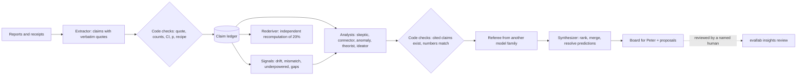

# Insight engine: always-on analysts over experiment results

`evallab insights` reads what experiments report, checks it, and keeps analyst
agents working on the whole body of results while new experiments run. It
implements Stage 6 (cross-trial synthesis) and the proposal half of Stage 7 of
[the analysis loop](analysis-loop.md) at the level of experiments rather than
single trials. Statistics come first and are computed by code; the agents look
for what statistics alone does not show.

## What it does



1. **Sources.** Coordinator findings logs, lane reports, results-folder reports,
   line scoreboards and committed experiment RESULTS, as listed in
   `config.yaml`. Markdown is split into sections; a section is extracted once
   and again only if its text changes.
2. **Claims.** The extractor writes one claim per number-bearing statement with
   a verbatim quote. Code fails a claim whose quote is absent, whose stated
   value or proportion disagrees with its k/n after unit normalization, or
   whose proportion interval is reversed or outside [0,1]. It still warns when
   a recomputed Wilson interval or exact McNemar p differs, and for split or
   in-sample caveats. Percent, fraction, count, currency and duration units stay
   distinct. A declarative `recipe` recomputes the number from receipts;
   `recipe.target` says whether the receipt should produce k, n or value, and
   the result is `reproduced`, `partial`, `differs` or `not_recomputable`. A claim is
   `reproduced` only when every number it states (k, n, value) was validated: by a
   `ratio` whose numerator and denominator equal k and n, or by the recipe plus
   companion recipes (`recipe.also`, each with its own `target`). A match that leaves a
   stated number unchecked is `partial` and names what it validated ("k matches
   receipt; n not checked"); `show`, the board's receipt coverage and the status
   counts keep `partial` apart from `reproduced`. A match on 0, 1 or 100 (0%, 100%)
   whose pointer names no cohort or metric word of the claim and has no `where` is
   also `partial` with the `weak_provenance` note. Older ledger rows keep their stored
   status. A recompute that
   differs from the stated value only within one extra rounding step of its printed
   digits (up to 0.55 of a unit of the last printed digit, such as a true 84.65%
   printed as 84.7%) is `reproduced` with a `rounding` note. Every `differs` records
   its size, absolute and in the claim's unit, and the receipt file and pointer it read
   against the claim field it compared, on the claim, in `show`, signals and
   `REPORT.md`. A `ratio` of two `count` recipes recomputes a rate such as 0/42.
3. **Signals.** Deterministic, precision-first statistics over the ledger:
   only matching quantities and cohorts are compared, known reader aliases are
   canonicalized, shared test identities are deduplicated, and multiplicity is
   scoped to a comparison family. Signals cover genuine measurement drift,
   stochastic extreme rates, underpowered tests, explicit result dependencies,
   explicitly absent detector-by-dataset cells and receipt discrepancies.
   Administrative counts, ambiguous units, independent reruns and bare nulls
   do not become research alarms.
4. **Analysts.** Each lens is a headless `omp -p` worker with a fixed brief
   (`src/evallab/insights/lenses/`), a bounded evidence pack and a read-only
   `./q` tool (SQL over the ledger, sources, statistics, recipe tests, output
   validation). Lenses read each other's recent cards, so a connector's link
   becomes a theorist's input and a skeptic's target.
   - *skeptic*: flaws in load-bearing claims and the cheapest decisive check;
   - *connector*: one mechanism behind results of two or more experiments;
   - *anomaly*: explains open signals from the underlying receipts;
   - *theorist*: mechanisms with falsifiable predictions in untested regions;
   - *ideator*: new experiments, reanalysis of existing data first, with cost.
5. **Quality control.** Code fails a card that cites an unknown, stale or
   failed claim, a "connection" inside one experiment, or an unsupported number
   in its title or statement. Other free-text fields warn on unsupported
   numbers. Numbers may come from cited claims, source sections, checked
   `computed` entries or card `recipes` re-run against receipts. A referee from
   a different model family restates each cited claim, tests the inference and
   its opposite, checks split/`in_sample` scope, and asks whether a proposed
   check gives different outputs under rival hypotheses. `revise` is only for a
   bounded repair to a sound central idea; there are no accept/reject quotas.
   The referee pack hides author model, pass id, timestamps, rank and previous
   grading, and batches by exact rendered size under `max_pack_chars`.
   Deterministic normalized-text matching archives exact or near-exact
   duplicates before grading; other cards receive nearest-card ids and scores.
   The synthesizer ranks surviving public cards and resolves predictions.
   Proposals always have `execution_authorized: false`.

   The low-cadence *twinmaker* uses the extractor's route family to write
   subtly corrupted twins of accepted cards (reversed conclusion, wrong unit,
   contradicted connection, non-discriminating check, correlation as cause or
   overclaimed scope), while keeping citations and numbers valid. Twins are
   hidden canaries: they never appear on the board or in analyst inputs. They
   are mixed without markers into referee batches beside their original
   controls, whose ids are withheld from twin nearest-card hints. Verdicts feed
   a 30-day calibration table; status and board report twin rejection and
   original acceptance with Wilson intervals. Defaults are two passes a day, a
   12-hour cooldown and at least four accepted source cards.
6. **Acceptance.** Only a named human accepts or rejects an insight:
   `evallab insights review <insight_id> accepted --by "Peter Makhnatch"`
   (same vocabulary and human-actor rule as [verdicts](verdicts.md)).

For a model-free lane audit, use [lane verification](lane-verification.md).
It checks receipt recipes, cited artifacts, PR claims, and nested session routes.

## Running it

```bash
uv run evallab insights init          # state dir with editable config.yaml and routes.yaml
uv run evallab insights status        # alive? what is each lens waiting for?
uv run evallab insights tick --dry-run
uv run evallab insights watch         # the always-on loop (one per state dir)
uv run evallab insights board         # re-render board.md / board.html
uv run evallab insights show I-...    # any claim, insight, signal, pass or experiment
uv run evallab insights query "SELECT experiment, statement FROM v_claims LIMIT 20"
uv run evallab insights experiment <folder>   # one experiment: claims.jsonl, validity, REPORT.md
```

### Reviewing one experiment

`evallab insights experiment FOLDER` writes `claims.jsonl`, `validity.json`,
`analysis.json` and a one-page `REPORT.md` to
`~/.local/state/evallab-insights/experiments/<name>-<digest>/` (or `--out`).
It extracts every report section, recomputes each claim that has a receipt
recipe, runs one skeptic pass and a cross-family referee on the result, and
re-derives a 20% sample of recipe-backed claims with a model from another
family. Every REPORT.md sentence cites a claim or finding id, the report is rejected
if it contains a number that is not in the ledger, and it aims to stay under 45
lines (a few headline claims, one bullet per skeptic card in its own words, counts
instead of per-claim lists).
Every pass of every lens gets the scheduler's single retry when it died at startup on
shared omp state (`SQLITE_BUSY`); the retry is decided by the same classification as
the watch loop, not by how long the failed pass took. Rederiver agreement compares like
with like: when the original and the rederived recipe target different quantities (a
count against a ratio, k against n), agreement means each side reproduces the claim.

- `--with OTHER_FOLDER` (repeatable) analyses related folders together, for
  example an experiment and the earlier receipts its README compares against.
  The folders are copied into one bundle so recipes can reach every receipt.
- `--attribution SPEC.json` builds the layer-attribution table (prevention
  layers block the reward; detection layers flag the run) with Wilson
  intervals and the Stage-4 paired test, and states how many cases a
  layer-value claim would need at the observed rate. The spec names the case
  rows (`cases_file`, `rows`, `case_id_field`, optional `where`) and each
  layer's field, matching values and role.
- `--no-agents` only re-checks an existing `claims.jsonl` and the receipts.

The validity scan treats only explicit split/answer-key markers and receipt data
paths as held-out evidence; an arbitrary string containing `test` is not enough.
`label_provenance` inventories label files, their producing code and shared
`load_labels` use. `scripted_positives` counts every positive case once (deduplicated
by id across bundle folders, summaries and pooled files, attributed to the smallest
file that holds it) and reports scripted k of all positives n per file and overall.
Missing label provenance counts only rows that actually carry a
label. Access-denied/refusal checks inspect metadata error/status fields, not
transcript or output content, to avoid mistaking analyzed text for an access
failure. `cohort_mix` fires when a pooled rate adds up rates of different cohorts
(counts that sum, or a statement naming the pooled rates) and when a rate about a
dataset the experiment never measures sits in a section of rates about another
dataset; rates that merely share a metric word are not flagged.

```bash
uv run evallab insights experiment research/experiments/ov-c1-c5-live-rollouts-20261101 \
  --with research/experiments/ov-safeguard-rollouts-20261031 \
  --with research/experiments/ov-safeguard-friction-v2-20261031 \
  --attribution research/experiments/insights-backtest-20261102/acceptance/c1c5-attribution.json
```

### Always on

`scripts/ops/launchd/install-insights.sh --load` installs the LaunchAgent
`com.petermakhnatch.evallab.insights` from a committed runtime snapshot, so the
engine survives worktree retirement and restarts with the Mac. Workers keep
running if the engine stops; on restart the engine adopts or collects them.

State lives in `$EVALLAB_INSIGHTS_STATE` (default
`~/.local/state/evallab-insights`): the SQLite ledger, one directory per pass
(brief, pack, session log, output), `board/`, `proposals/` and
`heartbeat.json`. Claims quote reports that can name third-party runs, so the
ledger is local runtime state and is never committed.

### Worker evidence boundary

Every pass gets a read-only SQLite snapshot and a sealed manifest of its inputs;
`./q` reads that snapshot, not live engine state. Editing `pack.json` or the
brief makes finalization fail. The rederiver's snapshot removes original
recipes, prior recompute outcomes and earlier rederivations. `q sql` is
read-only, bounded to 200 rows, 1 MB and about five seconds; `q locate` finds
receipt JSON pointers and recipe templates for a k, n or value, which still
need `q recipe` to verify.

Workers may read their own pass, the configured source roots and the read-only
mirror. `allowed_read_roots` adds optional roots. At finalize the engine scans
non-write session tool calls, including bash command strings, for absolute or
`~` paths outside those roots and for any access to live state or another pass.
`scope_policy: flag` (the default) records `scope_violations` and adds a visible
warning to imported claims/cards; `scope_policy: reject` fails the pass without
importing its output. For a backtest, set `scope_policy: reject` with the
snapshot as the only root.

## Scheduling and models

Each tick collects finished passes, refreshes the engine-owned
`.worktrees/insights-readonly` mirror of `origin/main` when due, scans sources,
rechecks affected cards, recomputes signals, starts what the schedule allows,
and re-renders the board. Between full ticks the watcher polls every five
seconds and collects/refills finished workers immediately. A lens runs when its
trigger is met, cooldown passed and 24-hour cap not reached. The skeptic reviews
every experiment systematically: a changed claims digest requeues it, each pass
covers up to `experiments_per_pass` (default 3), and `max_parallel` passes claim
disjoint experiments. Failed passes do not advance coverage or watermarks.

`evallab insights status` says in plain words what each lens has, needs and is
waiting for. The engine reloads `config.yaml` at each tick, keeping the last
valid values if an edit is broken; `routes.yaml` is read at start. Content
failures back off exponentially per lens and input set. Quota parks a route
until its reset, authentication failure parks its provider for 24 hours, and a
route that served another model parks for an hour. Workers started in one refill
are spaced by `launch_stagger_seconds` (default 4), and a transient omp database
startup failure (`SQLITE_BUSY` on `agent.db`) gets up to two retries after a 15-45 s
pause jittered by the pass id, in the watch loop and in one-shot experiment runs.

Models are chosen by `routes.yaml`, never ad hoc: the first route whose provider
is under `max_provider_used_percent`, not parked, and (for referee/rederiver)
not the input authors' family. Each pass records the requested and attested
served model. These routes choose analyst models only, never models an
experiment evaluates. Twinmaker reuses the extractor route family.

The host gate follows current macOS pressure, not allocated swap: critical
pressure blocks; warn pressure blocks below `host_min_memory_level` free
percent; and more than `host_max_swap_growth_gb` (default 2 GB) swap growth over
an engine-measured five minutes blocks with that reason in status. Probe
failures are non-blocking.

## What is checked by code and what is judged by a model

| Checked by code | Judged by a model |
|---|---|
| verbatim quotes; value/k/n/unit and interval scale | whether a claim is load-bearing |
| Wilson intervals and exact McNemar p (warnings) | whether cited claims license the inference or its opposite |
| receipt recipes and explicit recipe targets | whether a mechanism explains the data |
| cited claims exist, are current and passed checks | novelty, importance and falsifiability (referee) |
| card numbers, computed statistics and card recipes | whether a proposed check separates rival hypotheses |
| normalized-text duplicates and nearest-card scores | ranking and merging (synthesizer) |
| worker read scope and referee independence | whether a prediction was resolved |
| hidden-twin/original calibration rates with Wilson intervals | |

## Limits

- Extraction quality bounds everything downstream; failed checks are visible
  on the claim, not silently dropped, and the rederiver measures agreement on a
  deterministic 20% sample of recipe-backed claims.
- The referee is one model family and checks a card against its cited claims,
  not against the receipts. On 118 real backtest cards it accepted all 15 that
  a blind receipt-recomputing audit rated only partly right, and each of the 7
  it did not accept was rated correct. A referee accept is therefore no
  evidence that a card is right. Canary rates measure the referee on planted
  corruption types only. Treat the board as a ranked queue for human review,
  not as findings.
- Measured quality, from two overnight backtests: the engine matched about half
  of what verifiers found later, the same as one strong single-session review,
  and the two found different items; 87% of its cards were fully correct
  against 66% for the single session
  ([backtest results](../research/experiments/insights-backtest-20261102/README.md)).
- Signals require compatible quantity types and cohort identities. Conservative
  matching suppresses false alarms but inconsistent naming or missing quantity
  metadata can still hide real drift until the entity registry catches up.
