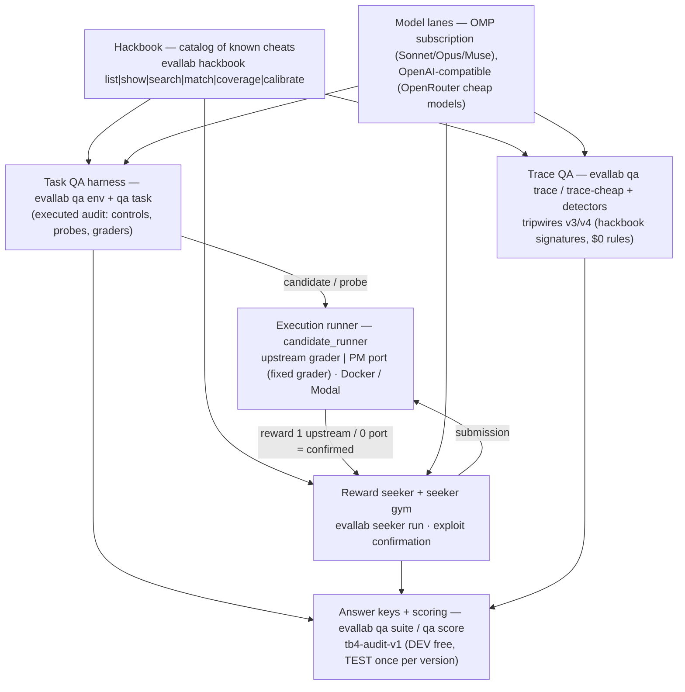

# The open QA harness: what was built on 2026-10-21, and how to run it

One day of work (about 00:10–16:30 ET, 2026-10-21) built an open QA system
that cheap models and subscription agents can drive: a catalog of known
cheats, an execution-backed task auditor, a reward seeker that tries to
cheat on purpose, trace tools that decide whether a run's reward was real,
and frozen answer keys to score all of it. This page is the map. Measured
numbers are quoted from the lane receipts in
`~/Developer/research-context/bridge/2026-10-21-harness/` (plus the
independent verifier's `status-0800.md`, written 06:40 ET — several lanes
landed more after it, noted where relevant). Treat this page as a guide,
not evidence: receipts and the answer keys are the evidence.



Everything runs from one checkout once installed:

```bash
uv sync --frozen --extra laminar   # Harbor 0.24 runtime
.venv/bin/evallab --help           # full command surface
```

API keys, when a lane needs one, come from the `keys` store (`keys has
NAME`, `keys run -- <cmd>`); no key is needed for the $0 commands below.

## 1. Hackbook — the catalog of known cheats

What it is: a versioned, machine-readable catalog of ways agents cheat and
tasks break — mechanism, signatures, a detection recipe, a probe template,
a fix pattern, and examples labelled `executed` / `observed` / `claimed`.

```bash
.venv/bin/evallab hackbook list
.venv/bin/evallab hackbook show HB-TS01-007
.venv/bin/evallab hackbook search "golden file"
.venv/bin/evallab hackbook match <task-dir> [--kind task|trace] [--direction false_pass] [--emit-findings DIR] [--json]
.venv/bin/evallab hackbook coverage [--json]
.venv/bin/evallab hackbook calibrate <pool-of-tasks-or-traces> [--write-rates FILE]
```

- Inputs/outputs: `match` takes a task package, an exported view, or a
  trace/trial dir and emits ranked entry hits (or `qa.finding/v1` findings
  with `--emit-findings`). `coverage` prints entries/examples by taxonomy
  class, source, and evidence status. Data: `research/hackbook/entries.jsonl`.
- Models/lanes: no model needed; entries are matched deterministically.
  Consumed by Task QA, the seeker, and the trace tools.
- Measured: 57 entries over 18 classes (#1126, #1131, later #1148/#1158/#1160);
  `coverage` on merged main reports 57 entries (48 task-side, 9 run-side),
  39/57 with executed evidence, 211 examples (74 executed / 2 observed /
  135 claimed). On the `tb4-audit-v1` DEV split (25 tasks, 86 findings),
  strict 1-to-1 category recall 68.6% (59/86), precision 48.4%, F1 0.567.
- Caveats: that recall is mostly in-sample — 47 of the 59 matched DEV
  findings are cited as catalog examples; on uncited DEV findings recall
  is 12/28 (43%). On full trajectories (not action-only views) the matcher
  flags clean passes about as often as wrong ones unless the outcome and
  task gates are used (`--outcome auto --task DIR`). The hackbook.md §3
  receipt table overcounts examples; `evallab hackbook coverage` is the
  live count. Verifier verdicts: `status-0800.md` rows 1–6.

## 2. Task QA harness — `qa env` (v2) and `qa task`

What it is: an agent that audits a task for defects — reads the task and
its grader, runs controls and candidate probes against the real graders,
and writes findings that are only counted once independently confirmed.

```bash
.venv/bin/evallab qa env audit --task <task-id> --view <sealed-view> --out <dir> --lane codex|omp|openai --model <model> --max-seconds <s> --max-tokens <n> --max-tool-calls <n> --max-usd <usd>
.venv/bin/evallab qa env task-info --request <request.json>
.venv/bin/evallab qa env run-upstream-grader --request <request.json>
.venv/bin/evallab qa env run-port-grader --request <request.json>
.venv/bin/evallab qa env run-reference | run-blank | probe | diff | hackbook | record-finding --request <request.json>
.venv/bin/evallab qa task --task <task-id> [--key tb4-audit-v1] [--split dev] [--plan]
.venv/bin/evallab qa task-score --key tb4-audit-v1 --findings <findings-dir>   # flagged vs verified; unmeasured never counts as pass
```

- Inputs/outputs: JSON-in/JSON-out tool surface for agents (`--request`),
  plus the staged `qa task` pipeline (S0 controls, S1 advisory rubric, S2
  shortcut + reference-subset hunt, S3 fresh replay confirmation).
  `--plan` is a $0 preview — no backend or model is constructed.
- Models/lanes: Codex exec, OMP subscription lanes (Sonnet/Opus, plus
  `meta/muse-wonder-1.0-contributor` in `OMP_MODELS`), and any
  OpenAI-compatible endpoint (OpenRouter). The cheap-model frontier ran
  through the same harness protocol (plain-read and source-only variants).
- Measured: v2 (#1133) merges the execution tools + hackbook lookup + three
  model lanes. Baselines it is compared against: plain read (Opus) 78/152
  and v1 80/152 on `tb4-audit-v1` TEST — those comparisons are
  model-confounded (different drivers). The cheap frontier's one frozen
  TEST run: Qwen (plain, json-v3) scored 6/152 category 1-to-1 (precision
  6/14, strict locus 0/152) after stopping at 9 of 41 tasks — 32
  unattempted tasks count as misses, so it is a partial run, not a
  same-coverage comparison (row 21 of `status-0800.md`). DEV-side json-v3
  was the robustness step: tolerant JSON extraction + one schema-repair
  retry; Qwen completed 3/3 DEV tasks while GPT-OSS/GLM did not finish
  within budget.
- Caveats: no frozen v2 Sonnet TEST campaign has run — the native OMP
  controller emitted malformed tool-call blocks in the DEV smoke, which
  still blocks a v2 freeze. A DEV controller smoke (Sonnet, 240 s /
  150 k tokens) stopped correctly at budget with 0 findings; that is a
  protocol limit found, not a score.

## 3. Execution runner — upstream/port candidate replay

What it is: the substrate the other lanes grade on. One API runs a
candidate (files, a patch, or an executable `solve.sh` bundle) against
either the original upstream grader or PM's fixed port, locally in Docker
or on Modal, with a hard spend ledger.

```python
from evallab.candidate_runner import run_candidate, run_candidates
result = run_candidate(task_dir, files={"answer.txt": "..."}, target_dir="/app", backend="docker", output_dir=fresh_dir)
result = run_candidate(task_dir, solution_bundle=bundle_dir, grader="port", port_task=port_dir, backend="modal",
                       max_usd=5, approval="...", spend_ledger=ledger_path,
                       modal_app_name="2026-10-21-harness-execution", billing_tag="2026-10-21-harness")
```

```bash
.venv/bin/python -m evallab.candidate_runner <task> --solution-bundle <dir> --grader upstream|port \
  [--port-task <dir>] [--backend auto|docker|modal] [--output-dir <fresh-dir>] [--plan]
```

- Backends and limits: Docker uses each task's declared CPU/memory
  exactly (never lowered); pre-existing unbounded host containers are
  charged a bounded reserve from observed usage so local grading is
  admitted on a 7.75 GiB Docker VM (#1140). Compose tasks and the
  PM-port verifier image run on Modal (Docker-in-Docker; the port image
  build skips rpm file capabilities Modal cannot set, #1150). Modal spend
  is reserved up front in a JSON ledger whose approval/cap cannot be
  changed in place — a top-up is a second ledger; reservations from
  failed builds stay committed.
- Coverage (66 TB4 task dirs): upstream runnable locally 31, on Modal
  only 32, not at all 3 (GPU tasks). The PM port went from 21 to 31
  shape-admitted tasks across #1154/#1163 (offline setup-recipe shapes
  and deterministic local transforms; see `docs/execution-tiers.md`).
- Measured: the five known PM exploit witnesses replay 1.0 upstream /
  0.0 port locally, 5/5 (#1140, independently re-replayed in
  `status-0800.md` row 18). On Modal: fin port measured 0.0 for its
  witness; a Compose task (heat-pump) measured upstream 1.0.
- Caveats: `status=error`/`refused` means unmeasured — never read it as
  reward 0. Local capacity moves with other lanes' containers; several
  port images no longer build for platform reasons (e.g. no arm64
  `tblite` wheel; an x86-only oracle tool), which `--platform
  linux/amd64` works around by emulation.

## 4. Reward seeker and seeker gym

What it is: a verifier-aware agent that reads the task + grader and tries
to get reward 1 by the shortest path, with no requirement to do the
intended work. Every claim is only real after differential replay (§3).

```bash
.venv/bin/python -m evallab.seeker run [--hackbook] ...
.venv/bin/python -m evallab.seeker validate | replay-upstream | report ...
# gym + training-data builders are experiment scripts:
ls research/experiments/seeker-gym-v0 research/experiments/tb4-reward-seeker-v3-20261021
```

- Drivers/lanes: Sonnet and Codex (subscription) and GPT-OSS-120b via
  OpenRouter; seeker tools are read/search/write only inside a sandbox
  (no host execution). `--hackbook` (RS-2, #1142) gives the seeker the
  top-8 matched hackbook mechanisms — claims on previously blank tasks
  went 0 → 8 of 17 valid submissions.
- Measured: v0 produced 71/75 structurally valid submissions on the 25
  TB4 DEV tasks (claimed exploits: Sonnet 11, Codex 10, GPT-OSS 15).
  After the full replay campaign, **3 exploits are confirmed** (upstream
  1.0 / port 0.0): Sonnet vf2 (RS-1, #1129) plus Sonnet and Codex
  fin-saccr-rwa after solve-time prompt facts (RS-2 follow-ups, #1151);
  all three match PM findings, none is new-vs-PM. Per-submission results:
  `bridge/2026-10-21-harness/seeker-replay.json`. Confirmed exploits per
  lane-paid dollar in v0: about $1.03 (GPT-OSS $0.98 + Modal $0.05).
- Caveats: generation is cheap, confirmation is the bottleneck — most
  submissions measure upstream 0, die in `solve.sh`, or sit on tasks this
  laptop cannot measure (≥8 GiB, GPU, Compose). The seeker gym's v0
  splits (seeker-training.md, #1156) include tb4-audit-v1 **TEST** tasks
  as sources — rejected for training as-is (leakage); the verifier's
  `status-0800.md` flags this. SFT pilots on seeker data are negative so
  far (flag-everything behaviour); no trained seeker is shipped.

## 5. Trace QA — `qa trace`, `qa trace-cheap`, tripwires, detectors

What it is: decide whether a finished run's reward was real. Deterministic
tripwire rules ($0, no model) screen first; a cheap judge is asked only
about a specific mechanism; the full T0–T4 review is the expensive tier.

```bash
.venv/bin/evallab qa trace-cheap <trial-dir|trajectory.json> [--model <openrouter-model>] [--offline] [--out finding.json]
.venv/bin/evallab qa trace run|review|batch|score ...
.venv/bin/evallab detectors list|score|run ...      # scored on labelled trace corpora
# tripwire rule measurement is experiment tooling:
ls research/experiments/tripwires-v3-hackbook-20261021 research/experiments/tripwires-v4-precision-20261021
```

- Corpus: 11,133 public TB4 trajectories downloaded (215.7 GB, #1113/#1137);
  the DEV census labelled 2,835 canonical trials — 14 known-exploit passes
  (1.3% of passes), 211 task-defect fails (12.2%). Labels are mechanism
  rules, not replay-confirmed.
- Measured: tripwires v3 (#1138) on CheatBench TEST: recall 20/75 vs legacy
  16/75, false alarms 9/75 vs 5/75 (+4 caught for +4 false alarms). The
  trace-cheap harness v3 (`qa-trace-sft-v0`, #1149/#1159-lineage): GPT-OSS
  discovery recall 0.20 vs confirmation 0.70 on the same 10 rows — it
  confirms candidates far better than it discovers them; the defect
  variant went 7/7 with 0/7 false alarms on n=7 TB4 rows only. The
  earlier "exploit recall 0.75" headline is 20 CheatBench rows, mostly
  the output envelope, not TB4 discovery.
- Caveats: mechanism labels from the census are leads; "neither" does not
  mean clean, and defect-credit numbers are upper bounds, not regraded
  passes. v3 spend ran $0.006 over its $0.60 cap. Eval3 (Tokenless) is a
  checked second yardstick (#1124) but 62 of its 65 environments are
  undisclosed, so no harness-vs-Eval3 score exists.

## 6. Answer keys and `qa suite`

What holds the scores: `research/answer-keys/` — chiefly `tb4-audit-v1`
(66 tasks, 238 findings; 25 DEV / 41 TEST), plus `tb2-to-tb21-v1`, MiMo
keys, trace keys (CheatBench/HackTrace action corpora), and the seeker's
DEV keys. Rules from `CONTRACT.md`: develop on DEV freely; each frozen
system version runs TEST **once**, logged in the key's exposure registry;
training data must exclude TEST tasks, findings, and trajectories.

```bash
.venv/bin/evallab qa suite --agent task --agent trace --version <producer-version> [--runs runs.json] [--json]
.venv/bin/evallab qa score --key tb4-audit-v1 --findings <findings-dir> [--split dev|test] [--json]
```

- Scoring is strict 1-to-1 on (task, category) in `score_audit.py`;
  unattempted tasks count as misses in the full-split denominator, and
  unmeasured cells never count as passes anywhere in this system.
- Exposure state at writing: the TEST guard shows one registered
  tb4-audit-v1 TEST system in the trace lineage plus RS/cheap-model runs
  logged per lane (Qwen json-v3 is the cheap frontier's single frozen
  TEST); TR-1's 6 legacy TEST-task rows were disclosed in its registry
  entry (`status-0800.md` row 17).

## 7. Cheap models and training pilots (brief)

- Frontier (#1122/#1125/#1133): GPT-OSS-120b, Qwen, GLM Flash, DeepSeek at
  <$1/M-token class prices drove the plain-read/source-only protocols;
  billing unknowns are carried as unresolved reservations, never zero.
- Distillation/SFT data v0 (`research/datasets/qa-sft-*`, #1136/#1143) is
  leak-checked against TEST; the MiMo Qwen3-8B LoRA pilot (#1146) is a
  **negative result** — near-perfect recall by flagging almost everything
  (false alarms 11/11, criterion ≤3/11 not met). 19 held-out MiMo rows
  were later found inside that pilot's train set (`status-0800.md` row
  10): the result stands as a negative, but do not reuse that split.

## What does not work yet

- **Frozen Task-QA v2 TEST score.** The campaign never froze: the OMP
  controller's tool-call format broke the DEV audit protocol. v2's
  80/152-class number does not exist yet; today's TEST comparisons are
  baselines and one partial cheap run.
- **A seeker that confirms its own claims.** Generation finds claims
  cheaply; only 3 of 89+ submissions are replay-confirmed, and every
  confirmed one matches a PM finding — no confirmed *new* exploit yet.
  The tasks most worth attacking are exactly the ones hard to measure
  locally (big-memory, GPU, Compose).
- **Trace discovery by cheap models.** Confirmation of a named mechanism
  works; open discovery recall is ~0.20. The census labels themselves
  are rule-based, so all downstream trace numbers inherit that.
- **Port coverage 31/66.** The remaining 35 ports refuse for stated
  reasons: sha-pinned assets whose local bytes differ (8), external-URL
  or image-layer setup fetches (8), generator-program recipes, two
  non-file judges, three GPU tasks, and one task with no port at all.
- **Eval3 as a scoreboard.** Its environment pool is mostly undisclosed;
  overlap with TB4 is unknown, so it cannot yet rank this harness.
- **Cost accounting as one bill.** Metered spend is genuinely small
  (≈$7.4 metered of the day's $20 by the verifier's count), but
  subscription/API-equivalent figures are estimates across lanes, and
  CO-1's cost-ledger PR (#1132) is still a draft.

## Where things live

| Piece | Code | Data / receipts |
|---|---|---|
| Hackbook | `src/evallab/hackbook/` | `research/hackbook/entries.jsonl` |
| Task QA | `src/evallab/qa/` (`env*`, `agent*`) | `research/experiments/tb4-qa-agent-v2-20261021/` |
| Execution | `src/evallab/candidate_runner.py`, `candidate_port.py`, `upstream_grader.py` | `docs/execution-tiers.md` |
| Seeker | `src/evallab/seeker/` | `research/experiments/tb4-reward-seeker-*-20261021/`, `seeker-gym-v0/` |
| Trace QA | `src/evallab/qa/trace*`, `tripwires.py` | `research/experiments/tripwires-v*-20261021/` |
| Keys/scoring | `research/answer-keys/`, `evallab qa suite` | `research/qa-scoreboard/` |

Day receipts: `~/Developer/research-context/bridge/2026-10-21-harness/`
(`CONTRACT.md` for ownership and budgets; `status-0800.md` for the
independent check; per-lane `*.md` for receipts). Verified against merged
main on 2026-10-21: every command block above was `--help`-checked on
that checkout.
